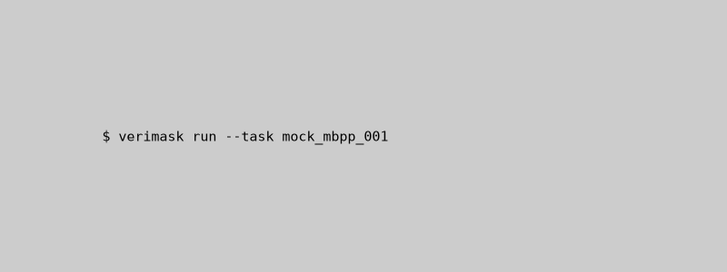
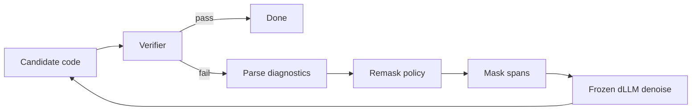

# verimask

<p align="center">
  <strong>Verifier-diagnosed remasking for diffusion language models</strong><br/>
  Learn <em>where</em> to remask from test & Lean diagnostics; let a frozen dLLM re-denoise only those spans.
</p>

<p align="center">
  <a href="./LICENSE"></a>
  <a href="./.github/workflows/ci.yml"></a>
  
  
</p>

<p align="center">
  
  <br/>
  <sub><strong>MOCK</strong> — scripted animation; not output from Dream-Coder-v0-Instruct-7B.</sub>
</p>

---

## Why verimask?

| Piece | Role |
| --- | --- |
| **Verifier** | Tests or Lean say *that* code failed and *where* |
| **Diagnostics parser** | Tracebacks, asserts, Lean spans → line hints |
| **Remask policy** | Chooses token spans + width (RL-trained) |
| **Frozen dLLM** | Re-denoises masked spans only (Dream-Coder 7B) |

Prior work remasks by **model confidence** (RemeDi) or **fixed heuristics** (error-line / subgoal blocks). verimask targets a **learned, diagnostic-conditioned** policy with a **sparsity penalty** — see [docs/RELATED_WORK.md](docs/RELATED_WORK.md).

## How it works



1. Run verifier (up to **K** rounds).
2. Parse stderr / Lean messages into spans (`verimask/diagnostics.py`).
3. Policy selects token indices (`verimask/policy.py`).
4. Denoiser fills masks (`verimask/denoiser.py` + `remask_denoise.py`).

## Quickstart

```bash
git clone https://github.com/Sebastianrodaaa/verimask.git && cd verimask
pip install -e ".[dev]"

# CPU: lint + tests (REAL parser tests; MOCK denoiser)
make lint test

# Rebuild MOCK failure set and run all arms (fixed seeds 11, 22, 33)
make repro

# MOCK terminal demo GIF
make demo
```

### GPU / Hugging Face (optional)

```bash
pip install -e ".[gpu]"
export VERIMASK_USE_HF=1
# Dream-Coder denoiser path (requires compatible transformers model class)
python -c "from verimask.denoiser import get_denoiser; get_denoiser('dream')"
```

AR baseline (`baselines/ar_repair.py`) uses **Qwen2.5-Coder-7B-Instruct** when `VERIMASK_USE_HF=1`.

## Project layout

```
verimask/
  diagnostics.py    # traceback + Lean → spans
  policy.py         # remask policy (trainable)
  remask_denoise.py # K-round repair loop
  train_rl.py       # REINFORCE / GRPO stub
  denoiser.py       # TinyStandIn (CPU) | Dream-Coder (GPU)
baselines/          # error_line, confidence, full_regen, ar_repair
scripts/
  build_failures.py
  run_repro.py
results/            # JSON from make repro
tests/mock_data/    # MOCK fixtures
docs/
  RELATED_WORK.md
  REPORT.md
```

## Results

<!-- RESULTS_TABLE_START -->
| Arm | Mean repair rate | Label |
| --- | ---: | --- |
| `ar_repair` | 0.000 | MOCK |
| `confidence` | 0.667 | MOCK |
| `error_line` | 0.000 | MOCK |
| `full_regen` | 0.667 | MOCK |
| `verimask_policy` | 0.667 | MOCK |
<!-- RESULTS_TABLE_END -->

> **MOCK:** Current table rows come from `TinyStandInDenoiser` on synthetic failures. Dream-Coder numbers require a GPU run.

## Reproduce

```bash
make repro   # == build-failures + run_repro.py (seeds 11, 22, 33)
```

## Related work

Short list: [Diffusion-Proof](https://arxiv.org/abs/2606.19315), [How Should Diffusion LMs Edit Code?](https://arxiv.org/abs/2609.38257), [RemeDi](https://arxiv.org/abs/2509.23653), [MDM-VGB](https://arxiv.org/abs/2606.28301), [Diffusion is a code repair operator](https://arxiv.org/abs/2508.11110). Full verified survey: [docs/RELATED_WORK.md](docs/RELATED_WORK.md).

## Limitations

- v0.1 scaffold: no Dream-Coder / MBPP+ numbers in this repo state unless you run GPU experiments.
- Lean v1.5 track is parser-ready only.
- Execution-trace guided remasking (heuristic baseline) is close in idea; verimask tests **learned** policies.

## License

- **Code:** [MIT](LICENSE)
- **Dream-Coder-v0-Instruct-7B:** [Apache-2.0](https://huggingface.co/dream-ai/Dream-Coder-v0-Instruct-7B) when used as denoiser
- **Datasets (planned v1):** MBPP+, HumanEval+ — use respective dataset licenses when downloading

## Citation

```bibtex
@software{verimask2026,
  title  = {verimask: Verifier-diagnosed remasking for diffusion LMs},
  year   = {2026},
  license = {MIT}
}
```

Research write-up: [docs/REPORT.md](docs/REPORT.md).
